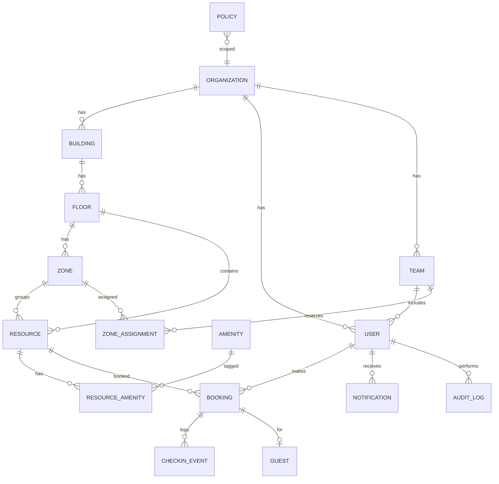

# seatMGT – Tài liệu yêu cầu sản phẩm (PRD)

| Thuộc tính | Giá trị |
|---|---|
| Phiên bản | 0.1 (Draft) |
| Ngày | 2026-11-20 |
| Trạng thái | Chờ review |
| Phạm vi | Văn phòng hybrid / hot-desk, phòng họp; mở rộng cho sự kiện |

> **Ghi chú bối cảnh:** Tại thời điểm soạn, repository chỉ có commit khởi tạo và `README.md` (`# 6mgt`), chưa có mã nguồn hay mô tả nghiệp vụ. Tài liệu này vì vậy được xây dựng từ mô tả sản phẩm, không ràng buộc bởi code hiện có. Tech stack ở mục 7 là **đề xuất**.

---

## 1. Tổng quan sản phẩm

### 1.1 Vấn đề
Mô hình làm việc hybrid khiến số người lên văn phòng biến động theo ngày. Doanh nghiệp gặp các vấn đề:
- Nhân viên lên văn phòng không có chỗ, hoặc không biết đồng nghiệp/team ngồi đâu.
- Ghế và phòng họp bị "giữ chỗ ảo" (đặt nhưng không đến).
- Bộ phận hành chính không có dữ liệu để tối ưu diện tích, cắt giảm chi phí mặt bằng.
- Quản lý chỗ ngồi đang làm thủ công bằng Excel/chat, dễ xung đột.

### 1.2 Giải pháp
**seatMGT** là nền tảng web (responsive, ưu tiên mobile) cho phép:
- Số hóa tòa nhà → tầng → khu → ghế/phòng trên sơ đồ trực quan.
- Nhân viên tự đặt, hủy và check-in (QR) chỗ ngồi/phòng họp.
- Áp dụng quy tắc đặt chỗ, tự động giải phóng chỗ không check-in.
- Cung cấp báo cáo tỷ lệ sử dụng cho quản lý và hành chính.

### 1.3 Mục tiêu
| # | Mục tiêu | Đo bằng |
|---|---|---|
| G1 | Nhân viên tìm và đặt chỗ trong < 30 giây | Thời gian trung vị từ mở app đến đặt xong |
| G2 | Giảm tỷ lệ no-show xuống < 10% | Booking hết hạn mà không check-in / tổng booking |
| G3 | Loại bỏ xung đột đặt chỗ (double booking) | 0 sự cố double booking |
| G4 | Cung cấp dữ liệu sử dụng mặt bằng theo ngày, tuần, tháng | Có dashboard báo cáo |

### 1.4 Non-goals (ngoài phạm vi)
- Không quản lý tài sản/thiết bị IT (asset management) chi tiết.
- Không xử lý chấm công, tính lương hay kiểm soát cửa ra vào phần cứng (chỉ tích hợp ở Phase 3 nếu cần).
- Không bán vé hay thanh toán cho sự kiện trong MVP.
- Không có ứng dụng native iOS/Android trong MVP (dùng PWA).
- Không thiết kế CAD/bản vẽ kiến trúc; chỉ import ảnh mặt bằng và đặt điểm.

### 1.5 Vai trò người dùng
| Vai trò | Mô tả | Quyền chính |
|---|---|---|
| **Admin** (Hành chính/IT) | Quản trị toàn hệ thống | Cấu hình tòa nhà/tầng/khu/ghế, quy tắc, phân quyền, tích hợp SSO/lịch, xem mọi báo cáo |
| **Quản lý** (Team lead/Trưởng phòng) | Quản lý một hoặc nhiều team/khu | Gán khu vực cho team, đặt hộ thành viên, duyệt yêu cầu, xem báo cáo của team |
| **Nhân viên** | Người dùng cuối | Xem sơ đồ, đặt/hủy/check-in ghế và phòng họp, tìm đồng nghiệp |
| **Khách** (Visitor) | Người ngoài công ty | Được nhân viên mời; nhận QR để check-in vào ghế/phòng đã đặt hộ; không đăng nhập đầy đủ |

---

## 2. Feature list

**Quy ước:**
- **MoSCoW:** M = Must, S = Should, C = Could, W = Won't (lần này)
- **Giai đoạn:** MVP, P2 (Phase 2), P3 (Phase 3)

### 2.1 Module A – Quản lý không gian (Tòa nhà / Tầng / Khu / Ghế)
| ID | Tính năng | MoSCoW | Giai đoạn |
|---|---|---|---|
| A1 | CRUD tòa nhà (tên, địa chỉ, múi giờ, giờ hoạt động) | M | MVP |
| A2 | CRUD tầng thuộc tòa nhà, upload ảnh mặt bằng (PNG/JPG/SVG) | M | MVP |
| A3 | CRUD khu (zone) trên tầng, vẽ polygon trên mặt bằng | M | MVP |
| A4 | CRUD ghế/bàn: mã, vị trí (x, y), loại (hot-desk, cố định, đứng) | M | MVP |
| A5 | CRUD phòng họp: sức chứa, tiện ích (TV, bảng, video call) | M | MVP |
| A6 | Gắn thuộc tính và tiện ích cho ghế (màn hình, gần cửa sổ, ổ cắm) | S | MVP |
| A7 | Bật/tắt (vô hiệu hóa) ghế hoặc khu tạm thời (bảo trì) | M | MVP |
| A8 | Import hàng loạt ghế từ CSV/Excel | S | P2 |
| A9 | Nhân bản cấu hình tầng | C | P2 |
| A10 | Layout cho sự kiện (hàng, dãy ghế, khu vực VIP) | C | P3 |

### 2.2 Module B – Sơ đồ chỗ ngồi trực quan
| ID | Tính năng | MoSCoW | Giai đoạn |
|---|---|---|---|
| B1 | Hiển thị sơ đồ tầng với trạng thái ghế theo màu (trống, đã đặt, của tôi, không khả dụng) | M | MVP |
| B2 | Chọn ngày và khung giờ để xem trạng thái tương ứng | M | MVP |
| B3 | Zoom/pan, hỗ trợ cảm ứng trên mobile | M | MVP |
| B4 | Tooltip/panel chi tiết ghế: tiện ích, người đang ngồi (nếu cho phép) | M | MVP |
| B5 | Bộ lọc theo tiện ích, loại ghế, khu | S | MVP |
| B6 | Tìm đồng nghiệp: "X hôm nay ngồi đâu?" | S | MVP |
| B7 | Chế độ xem danh sách (accessibility, thay thế sơ đồ) | S | MVP |
| B8 | Hiển thị vị trí team, gợi ý ngồi gần team | C | P2 |
| B9 | Cập nhật trạng thái realtime (WebSocket/SSE) | S | P2 |
| B10 | Sơ đồ editor kéo-thả cho Admin | S | P2 |

### 2.3 Module C – Đặt / Hủy / Check-in
| ID | Tính năng | MoSCoW | Giai đoạn |
|---|---|---|---|
| C1 | Đặt ghế theo ngày (cả ngày, sáng, chiều) | M | MVP |
| C2 | Đặt phòng họp theo khung giờ (bước 15 phút) | M | MVP |
| C3 | Hủy booking (trước giờ bắt đầu) | M | MVP |
| C4 | Check-in bằng quét QR dán tại ghế/phòng | M | MVP |
| C5 | Check-in thủ công trên app (nếu bật geofence/Wi-Fi thì kiểm tra) | S | P2 |
| C6 | Tự động giải phóng booking nếu không check-in sau X phút | M | MVP |
| C7 | Check-out sớm để giải phóng chỗ | S | MVP |
| C8 | Danh sách "Booking của tôi" (sắp tới, lịch sử) | M | MVP |
| C9 | Đặt lặp lại (hằng tuần, các ngày cụ thể) | S | P2 |
| C10 | Quản lý đặt hộ thành viên team | S | P2 |
| C11 | Đặt chỗ cho khách và gửi QR qua email | S | P2 |
| C12 | Danh sách chờ (waitlist) khi hết chỗ | C | P3 |
| C13 | Đăng ký và check-in sự kiện | C | P3 |

### 2.4 Module D – Quy tắc đặt chỗ và xử lý xung đột
| ID | Tính năng | MoSCoW | Giai đoạn |
|---|---|---|---|
| D1 | Chặn double booking ở tầng DB (ràng buộc khoảng thời gian không chồng lấn) | M | MVP |
| D2 | Giới hạn 1 ghế / người / khung thời gian | M | MVP |
| D3 | Cửa sổ đặt trước tối đa (ví dụ 14 ngày) | M | MVP |
| D4 | Thời gian ân hạn check-in (ví dụ 30 phút) và tự hủy | M | MVP |
| D5 | Ghế cố định hoặc khu dành riêng cho team/người cụ thể | S | MVP |
| D6 | Giới hạn công suất tầng/tòa (ví dụ tối đa 70%) | S | P2 |
| D7 | Phạt no-show (tạm khóa quyền đặt sau N lần) | C | P2 |
| D8 | Cấu hình quy tắc theo phạm vi (toàn cục → tòa → tầng → khu) | S | P2 |
| D9 | Luồng phê duyệt cho khu/phòng đặc biệt | C | P3 |

### 2.5 Module E – Xác thực và phân quyền
| ID | Tính năng | MoSCoW | Giai đoạn |
|---|---|---|---|
| E1 | Đăng nhập email và mật khẩu (+ đặt lại mật khẩu) | M | MVP |
| E2 | RBAC 4 vai trò: Admin, Quản lý, Nhân viên, Khách | M | MVP |
| E3 | Phân quyền theo phạm vi (Quản lý chỉ thấy team/khu của mình) | M | MVP |
| E4 | Quản lý người dùng, phòng ban, team | M | MVP |
| E5 | Audit log thao tác quản trị | S | MVP |
| E6 | SSO (OIDC/SAML: Google Workspace, Microsoft Entra ID) | S | P2 |
| E7 | Đồng bộ người dùng tự động (SCIM) | C | P3 |
| E8 | Multi-tenant (nhiều công ty trên một hệ thống) | C | P3 |

### 2.6 Module F – Thông báo
| ID | Tính năng | MoSCoW | Giai đoạn |
|---|---|---|---|
| F1 | Email xác nhận đặt hoặc hủy | M | MVP |
| F2 | Nhắc check-in trước giờ bắt đầu | S | MVP |
| F3 | Thông báo booking bị tự hủy do không check-in | M | MVP |
| F4 | Thông báo trong app (in-app notification center) | S | P2 |
| F5 | Web push (PWA) | C | P2 |
| F6 | Tích hợp Slack/Microsoft Teams | C | P3 |
| F7 | Tùy chỉnh tùy chọn nhận thông báo theo người dùng | S | P2 |

### 2.7 Module G – Báo cáo và phân tích
| ID | Tính năng | MoSCoW | Giai đoạn |
|---|---|---|---|
| G1 | Dashboard tỷ lệ sử dụng theo ngày, tòa, tầng, khu | M | MVP |
| G2 | Tỷ lệ no-show, tỷ lệ hủy | M | MVP |
| G3 | Xuất CSV | M | MVP |
| G4 | Heatmap mức sử dụng trên sơ đồ | S | P2 |
| G5 | Xu hướng theo ngày trong tuần, giờ cao điểm | S | P2 |
| G6 | Báo cáo theo phòng ban/team | S | P2 |
| G7 | Gợi ý tối ưu diện tích (khu ít dùng) | C | P3 |
| G8 | Báo cáo định kỳ gửi email | C | P3 |

### 2.8 Module H – Tích hợp
| ID | Tính năng | MoSCoW | Giai đoạn |
|---|---|---|---|
| H1 | Xuất file `.ics` cho booking | S | MVP |
| H2 | Đồng bộ hai chiều Google Calendar / Outlook (phòng họp) | S | P2 |
| H3 | SSO (xem E6) | S | P2 |
| H4 | Public REST API và webhook | C | P3 |
| H5 | Tích hợp HRIS (đồng bộ phòng ban) | C | P3 |
| H6 | Màn hình kiosk/tablet trước phòng họp | C | P3 |
| W1 | Tích hợp phần cứng cảm biến hiện diện | W | – |

---

## 3. User stories và Acceptance criteria (MVP)

### US-01 – Xem sơ đồ chỗ ngồi (B1, B2, B4)
> **Là** nhân viên, **tôi muốn** xem sơ đồ tầng với trạng thái ghế theo ngày, **để** chọn được chỗ phù hợp.

- **Given** tôi đã đăng nhập và tầng "Tầng 5" có 40 ghế, trong đó 10 ghế đã được đặt cho ngày 2026-12-01
  **When** tôi chọn tòa A, Tầng 5, ngày 2026-12-01
  **Then** sơ đồ hiển thị 30 ghế màu "trống" và 10 ghế màu "đã đặt", ghế vô hiệu hóa hiển thị màu xám.
- **Given** sơ đồ đang hiển thị
  **When** tôi chạm vào một ghế
  **Then** panel chi tiết hiện mã ghế, khu, tiện ích và nút "Đặt chỗ" (nếu ghế còn trống).
- **Given** tôi đã có booking ghế A5-12 ngày đó
  **When** sơ đồ tải xong
  **Then** ghế A5-12 hiển thị màu "của tôi".

### US-02 – Đặt ghế (C1, D1, D2, D3)
> **Là** nhân viên, **tôi muốn** đặt một ghế trống cho một ngày, **để** chắc chắn có chỗ khi lên văn phòng.

- **Given** ghế A5-12 trống vào ngày 2026-12-01 (cả ngày) và tôi chưa có booking nào ngày đó
  **When** tôi bấm "Đặt chỗ" và xác nhận
  **Then** booking được tạo với trạng thái `CONFIRMED`, ghế chuyển sang "của tôi" và tôi nhận email xác nhận.
- **Given** tôi đã có booking ghế khác ngày 2026-12-01
  **When** tôi đặt thêm ghế A5-12 cùng khung giờ
  **Then** hệ thống từ chối với thông báo "Bạn đã có chỗ trong khung giờ này".
- **Given** hai người cùng đặt ghế A5-12 cùng khung giờ gần như đồng thời
  **When** cả hai yêu cầu tới server
  **Then** chỉ một yêu cầu thành công; yêu cầu còn lại nhận lỗi `409 Conflict` và thông báo "Ghế vừa được người khác đặt".
- **Given** quy tắc đặt trước tối đa là 14 ngày
  **When** tôi chọn một ngày cách hôm nay 20 ngày
  **Then** ngày đó bị vô hiệu hóa trên date picker và API trả lỗi `422` nếu bị gọi trực tiếp.

### US-03 – Đặt phòng họp (C2, A5)
> **Là** nhân viên, **tôi muốn** đặt phòng họp theo khung giờ, **để** tổ chức cuộc họp.

- **Given** phòng "Hà Nội" (sức chứa 8) trống từ 14:00 đến 15:00
  **When** tôi đặt 14:00–15:00, nhập tiêu đề và số người là 6
  **Then** booking được tạo và tôi có thể tải file `.ics`.
- **Given** phòng đã có booking 14:30–15:30
  **When** tôi đặt 14:00–15:00
  **Then** hệ thống báo xung đột và gợi ý khung giờ hoặc phòng trống gần nhất.
- **Given** tôi nhập số người là 12, vượt sức chứa 8
  **When** tôi xác nhận
  **Then** hệ thống cảnh báo vượt sức chứa và không cho đặt.

### US-04 – Hủy booking (C3, C8)
> **Là** nhân viên, **tôi muốn** hủy booking, **để** nhường chỗ khi kế hoạch thay đổi.

- **Given** tôi có booking sắp tới
  **When** tôi bấm "Hủy" trong "Booking của tôi" và xác nhận
  **Then** trạng thái chuyển sang `CANCELLED`, chỗ được giải phóng ngay trên sơ đồ và tôi nhận email xác nhận hủy.
- **Given** booking đã bắt đầu và đã check-in
  **When** tôi xem booking đó
  **Then** nút "Hủy" được thay bằng "Check-out".

### US-05 – Check-in bằng QR (C4)
> **Là** nhân viên, **tôi muốn** quét QR tại ghế để check-in, **để** xác nhận tôi đang ngồi đó.

- **Given** tôi có booking ghế A5-12 hôm nay từ 08:00 và bây giờ là 08:10
  **When** tôi quét QR dán tại ghế A5-12
  **Then** booking chuyển sang `CHECKED_IN` và hiển thị thông báo thành công.
- **Given** tôi không có booking cho ghế A5-12 nhưng ghế đang trống
  **When** tôi quét QR
  **Then** hệ thống đề nghị "Đặt nhanh và check-in ngay" (walk-in).
- **Given** ghế A5-12 đang được người khác đặt
  **When** tôi quét QR
  **Then** hệ thống báo ghế đã có người đặt và gợi ý ghế trống gần nhất.
- **Given** còn hơn 30 phút trước giờ bắt đầu
  **When** tôi quét QR
  **Then** hệ thống báo "Chưa đến giờ check-in".

### US-06 – Tự động giải phóng chỗ (C6, D4, F3)
> **Là** Admin, **tôi muốn** booking không check-in bị tự hủy sau thời gian ân hạn, **để** giảm giữ chỗ ảo.

- **Given** thời gian ân hạn là 30 phút và booking bắt đầu lúc 09:00 chưa check-in
  **When** đến 09:30
  **Then** booking chuyển sang `NO_SHOW`, ghế trở thành trống và người đặt nhận email thông báo.
- **Given** booking đã check-in lúc 09:15
  **When** đến 09:30
  **Then** booking không bị thay đổi.

### US-07 – Quản lý không gian (A1–A5, A7)
> **Là** Admin, **tôi muốn** tạo tòa nhà, tầng, khu và đặt ghế lên ảnh mặt bằng, **để** số hóa văn phòng.

- **Given** tôi là Admin
  **When** tôi tạo tòa "A", tầng "5", upload ảnh mặt bằng và click vào các vị trí để tạo ghế
  **Then** mỗi ghế được lưu với tọa độ (x, y) tương đối theo ảnh và một mã QR duy nhất được sinh ra.
- **Given** ghế A5-12 có booking trong tương lai
  **When** tôi vô hiệu hóa ghế
  **Then** hệ thống cảnh báo số booking bị ảnh hưởng; nếu xác nhận, các booking đó bị hủy và người dùng được thông báo.
- **Given** tôi là Nhân viên
  **When** tôi truy cập trang quản trị không gian
  **Then** hệ thống trả lỗi `403`.

### US-08 – Phân quyền theo phạm vi (E2, E3, D5)
> **Là** Quản lý, **tôi muốn** dành riêng một khu cho team mình, **để** team ngồi gần nhau.

- **Given** tôi là Quản lý của team "Payments" và được Admin giao khu "5B"
  **When** tôi đặt khu 5B ở chế độ "chỉ team Payments"
  **Then** nhân viên ngoài team thấy ghế trong 5B ở trạng thái "không khả dụng".
- **Given** tôi là Quản lý team "Payments"
  **When** tôi mở báo cáo
  **Then** tôi chỉ thấy dữ liệu của team và khu được giao.

### US-09 – Tìm đồng nghiệp (B6)
> **Là** nhân viên, **tôi muốn** tìm xem đồng nghiệp ngồi đâu hôm nay, **để** gặp trực tiếp.

- **Given** đồng nghiệp B đã đặt ghế A5-20 hôm nay và bật chia sẻ vị trí
  **When** tôi tìm "B"
  **Then** kết quả hiển thị tòa, tầng, ghế và nút "Xem trên sơ đồ".
- **Given** đồng nghiệp C tắt chia sẻ vị trí
  **When** tôi tìm "C"
  **Then** kết quả chỉ hiển thị "Có lên văn phòng hôm nay" hoặc không hiển thị (tùy cấu hình quyền riêng tư).

### US-10 – Báo cáo tỷ lệ sử dụng (G1–G3)
> **Là** Admin, **tôi muốn** xem tỷ lệ sử dụng và no-show theo khoảng thời gian, **để** tối ưu mặt bằng.

- **Given** có dữ liệu booking 30 ngày qua
  **When** tôi chọn tòa A, khoảng 30 ngày
  **Then** dashboard hiển thị tỷ lệ sử dụng (số ghế đã check-in / số ghế khả dụng), tỷ lệ no-show và biểu đồ theo ngày.
- **Given** dashboard đang hiển thị
  **When** tôi bấm "Xuất CSV"
  **Then** file CSV được tải về với dữ liệu khớp bộ lọc.

### US-11 – Đăng nhập và quản lý người dùng (E1, E4)
> **Là** Admin, **tôi muốn** mời người dùng và gán vai trò, **để** kiểm soát quyền truy cập.

- **Given** tôi là Admin
  **When** tôi mời email `user@company.com` với vai trò Nhân viên, team "Payments"
  **Then** người dùng nhận email kích hoạt có hiệu lực 72 giờ.
- **Given** người dùng nhập sai mật khẩu 5 lần liên tiếp
  **When** đăng nhập lần thứ 6
  **Then** tài khoản bị khóa tạm 15 phút.

---

## 4. Mô hình dữ liệu

### 4.1 Sơ đồ quan hệ (rút gọn)

### 4.2 Chi tiết entity

| Entity | Thuộc tính chính | Ghi chú |
|---|---|---|
| **Organization** | `id`, `name`, `slug`, `default_timezone`, `locale`, `created_at` | Chuẩn bị cho multi-tenant (P3) |
| **Building** | `id`, `org_id`, `name`, `address`, `timezone`, `open_time`, `close_time`, `is_active` | |
| **Floor** | `id`, `building_id`, `name`, `level`, `floorplan_url`, `width`, `height`, `is_active` | Kích thước ảnh để quy đổi tọa độ |
| **Zone** | `id`, `floor_id`, `name`, `polygon` (JSON), `color`, `is_active` | |
| **Resource** | `id`, `floor_id`, `zone_id?`, `type` (`DESK`/`ROOM`/`EVENT_SEAT`), `code`, `name`, `x`, `y`, `capacity`, `booking_mode` (`HOT`/`FIXED`/`RESTRICTED`), `fixed_user_id?`, `qr_token`, `is_active` | Ghế và phòng họp dùng chung bảng, phân biệt bằng `type` |
| **Amenity** | `id`, `org_id`, `key`, `label_vi`, `label_en`, `icon` | Ví dụ: monitor, window, tv |
| **ResourceAmenity** | `resource_id`, `amenity_id` | Bảng nối N–N |
| **User** | `id`, `org_id`, `email`, `full_name`, `password_hash?`, `role` (`ADMIN`/`MANAGER`/`EMPLOYEE`), `team_id?`, `locale`, `share_location`, `status`, `failed_logins`, `locked_until?`, `external_idp_id?` | `password_hash` null khi dùng SSO |
| **Team** | `id`, `org_id`, `name`, `department`, `manager_id` | |
| **ZoneAssignment** | `id`, `zone_id`, `team_id`, `valid_from`, `valid_to?` | Khu dành riêng cho team |
| **Booking** | `id`, `resource_id`, `user_id`, `created_by_id`, `guest_id?`, `start_at`, `end_at`, `status` (`CONFIRMED`/`CHECKED_IN`/`CHECKED_OUT`/`CANCELLED`/`NO_SHOW`), `title?`, `attendee_count?`, `recurrence_id?`, `source` (`WEB`/`QR`/`CALENDAR`), `created_at`, `cancelled_at?` | Ràng buộc exclusion chống chồng lấn trên (`resource_id`, `tstzrange(start_at, end_at)`) khi status đang hoạt động |
| **CheckinEvent** | `id`, `booking_id`, `type` (`CHECK_IN`/`CHECK_OUT`), `method` (`QR`/`MANUAL`/`AUTO`), `occurred_at` | |
| **Guest** | `id`, `org_id`, `full_name`, `email`, `host_user_id`, `qr_token`, `expires_at` | |
| **Policy** | `id`, `org_id`, `scope_type` (`ORG`/`BUILDING`/`FLOOR`/`ZONE`), `scope_id`, `max_advance_days`, `checkin_grace_minutes`, `checkin_open_minutes_before`, `max_active_bookings`, `capacity_limit_pct?`, `noshow_penalty_threshold?` | Quy tắc cấp hẹp ghi đè cấp rộng |
| **Notification** | `id`, `user_id`, `type`, `channel` (`EMAIL`/`IN_APP`/`PUSH`), `payload` (JSON), `sent_at`, `read_at?` | |
| **AuditLog** | `id`, `org_id`, `actor_id`, `action`, `entity_type`, `entity_id`, `diff` (JSON), `ip`, `created_at` | |

### 4.3 Ràng buộc quan trọng
- **Chống double booking:** PostgreSQL `EXCLUDE USING gist (resource_id WITH =, tstzrange(start_at, end_at) WITH &&) WHERE (status IN ('CONFIRMED','CHECKED_IN'))`.
- **Một chỗ / người / khung giờ:** ràng buộc exclusion tương tự trên `user_id` cho `type = DESK`.
- Mọi thời gian lưu ở UTC; hiển thị theo `building.timezone`.
- `qr_token` là chuỗi ngẫu nhiên không đoán được, có thể xoay vòng (rotate).

---

## 5. API endpoint chính

REST, prefix `/api/v1`, JSON, xác thực bằng JWT access token (cookie HttpOnly) và refresh token.

### 5.1 Xác thực và người dùng
| Method | Endpoint | Mô tả | Vai trò |
|---|---|---|---|
| POST | `/auth/login` | Đăng nhập email và mật khẩu | Public |
| POST | `/auth/refresh` | Làm mới token | Public (có refresh token) |
| POST | `/auth/logout` | Đăng xuất | Đã đăng nhập |
| POST | `/auth/forgot-password` | Gửi email đặt lại mật khẩu | Public |
| POST | `/auth/reset-password` | Đặt lại mật khẩu | Public (có token) |
| GET | `/auth/sso/{provider}` | Bắt đầu luồng SSO (P2) | Public |
| GET | `/me` | Thông tin người dùng hiện tại | Đã đăng nhập |
| PATCH | `/me` | Cập nhật ngôn ngữ, chia sẻ vị trí, tùy chọn thông báo | Đã đăng nhập |
| GET/POST | `/users` | Danh sách, mời người dùng | Admin |
| PATCH/DELETE | `/users/{id}` | Sửa vai trò, team, vô hiệu hóa | Admin |
| GET/POST | `/teams` | Quản lý team | Admin |
| PATCH | `/teams/{id}` | Cập nhật team | Admin, Quản lý (team mình) |

### 5.2 Không gian
| Method | Endpoint | Mô tả | Vai trò |
|---|---|---|---|
| GET/POST | `/buildings` | Danh sách, tạo tòa nhà | Đọc: tất cả; Ghi: Admin |
| GET/PATCH/DELETE | `/buildings/{id}` | Chi tiết, sửa, xóa | như trên |
| GET/POST | `/buildings/{id}/floors` | Tầng của tòa | như trên |
| GET/PATCH/DELETE | `/floors/{id}` | Chi tiết tầng | như trên |
| POST | `/floors/{id}/floorplan` | Upload ảnh mặt bằng | Admin |
| GET/POST | `/floors/{id}/zones` | Khu của tầng | như trên |
| GET/POST | `/floors/{id}/resources` | Ghế và phòng của tầng | như trên |
| PATCH/DELETE | `/resources/{id}` | Sửa, xóa ghế/phòng | Admin |
| POST | `/resources/{id}/qr/rotate` | Tạo lại mã QR | Admin |
| GET | `/resources/{id}/qr.png` | Tải QR để in | Admin |
| POST | `/zones/{id}/assignments` | Gán khu cho team | Admin, Quản lý (khu được giao) |
| GET | `/amenities` | Danh sách tiện ích | Tất cả |

### 5.3 Sơ đồ và tình trạng
| Method | Endpoint | Mô tả | Vai trò |
|---|---|---|---|
| GET | `/floors/{id}/availability?date=&from=&to=&amenities=` | Trạng thái từng ghế/phòng trên tầng theo thời gian | Đã đăng nhập |
| GET | `/resources/search?building=&type=&from=&to=&capacity=&amenities=` | Tìm chỗ trống theo tiêu chí | Đã đăng nhập |
| GET | `/people/locate?q=&date=` | Tìm đồng nghiệp | Đã đăng nhập |

### 5.4 Booking
| Method | Endpoint | Mô tả | Vai trò |
|---|---|---|---|
| POST | `/bookings` | Tạo booking (`resource_id`, `start_at`, `end_at`, `for_user_id?`, `guest?`) | Đã đăng nhập |
| GET | `/bookings?mine=true&status=&from=&to=` | Danh sách booking | Đã đăng nhập (Admin/Quản lý xem theo phạm vi) |
| GET | `/bookings/{id}` | Chi tiết | Chủ booking, Quản lý, Admin |
| PATCH | `/bookings/{id}` | Đổi giờ hoặc ghế (kiểm tra xung đột lại) | Chủ booking, Admin |
| POST | `/bookings/{id}/cancel` | Hủy | Chủ booking, Quản lý, Admin |
| POST | `/bookings/{id}/checkout` | Check-out sớm | Chủ booking |
| GET | `/bookings/{id}/ics` | Tải file lịch | Chủ booking |
| POST | `/checkin` | Check-in bằng `qr_token` (body) | Đã đăng nhập, hoặc Khách có token |

**Mã lỗi chuẩn:** `400` dữ liệu sai · `401` chưa xác thực · `403` không đủ quyền · `404` không tìm thấy · `409` xung đột đặt chỗ · `422` vi phạm quy tắc (policy) · `429` vượt giới hạn tần suất.

### 5.5 Quy tắc, báo cáo, hệ thống
| Method | Endpoint | Mô tả | Vai trò |
|---|---|---|---|
| GET/POST | `/policies` | Danh sách, tạo quy tắc theo phạm vi | Admin |
| PATCH/DELETE | `/policies/{id}` | Sửa, xóa quy tắc | Admin |
| GET | `/reports/utilization?scope=&from=&to=&group_by=` | Tỷ lệ sử dụng | Admin, Quản lý (phạm vi) |
| GET | `/reports/noshow?scope=&from=&to=` | Tỷ lệ no-show, hủy | Admin, Quản lý |
| GET | `/reports/export.csv?type=&...` | Xuất CSV | Admin, Quản lý |
| GET | `/notifications` | Thông báo in-app (P2) | Đã đăng nhập |
| GET | `/audit-logs` | Nhật ký thao tác | Admin |
| GET | `/health` | Health check | Public |

---

## 6. Yêu cầu phi chức năng

| Nhóm | Yêu cầu | Chỉ tiêu |
|---|---|---|
| **Hiệu năng** | Thời gian phản hồi API đọc (availability, search) | p95 < 300 ms |
| | Thời gian phản hồi API ghi (tạo booking) | p95 < 500 ms |
| | Tải sơ đồ tầng 500 ghế trên mobile 4G | < 2 giây (LCP) |
| | Tải đồng thời | 1.000 người dùng đồng thời; 50 booking/giây giờ cao điểm 8–9h |
| **Bảo mật** | Xác thực | JWT ngắn hạn (15 phút) + refresh token xoay vòng; bcrypt/argon2 cho mật khẩu |
| | Phân quyền | RBAC kiểm tra ở server cho mọi endpoint; kiểm tra phạm vi (tenant/team) |
| | Truyền tải và lưu trữ | TLS 1.2+; mã hóa dữ liệu nhạy cảm khi lưu; secrets trong secret manager |
| | Ứng dụng | Theo OWASP ASVS L2: chống CSRF, XSS, SQL injection; rate limit đăng nhập và check-in |
| | Quyền riêng tư | Tuân thủ Nghị định 13/2023/NĐ-CP về bảo vệ dữ liệu cá nhân; người dùng tự bật/tắt chia sẻ vị trí; lưu dữ liệu booking tối đa 24 tháng (cấu hình được) |
| | Kiểm toán | Audit log cho mọi thao tác quản trị, lưu ≥ 12 tháng |
| **Khả dụng** | Uptime | ≥ 99,5% / tháng (MVP), ≥ 99,9% (P2) |
| | Sao lưu | Backup DB hằng ngày, PITR 7 ngày; RPO ≤ 1 giờ, RTO ≤ 4 giờ |
| | Giám sát | Log tập trung, metrics, alert khi lỗi 5xx > 1% hoặc job tự hủy no-show không chạy |
| | Job nền | Job giải phóng no-show chạy mỗi phút, idempotent, có retry |
| **Đa ngôn ngữ** | Ngôn ngữ | Tiếng Việt (mặc định) và tiếng Anh trong MVP; kiến trúc i18n cho phép thêm ngôn ngữ |
| | Định dạng | Ngày giờ, số theo locale; múi giờ theo tòa nhà |
| | Nội dung | Email template và dữ liệu danh mục (tiện ích) có bản dịch |
| **Khả năng sử dụng** | Responsive | Hỗ trợ từ 360 px; PWA có thể cài lên màn hình chính |
| | Accessibility | WCAG 2.1 AA; có chế độ danh sách thay thế cho sơ đồ |
| | Trình duyệt | 2 phiên bản mới nhất của Chrome, Edge, Safari, Firefox |
| **Khả năng bảo trì** | Kiểm thử | Unit test coverage ≥ 70% phần domain; E2E cho luồng đặt, check-in |
| | CI/CD | Lint, test, build tự động mỗi PR; deploy staging tự động |
| | Tài liệu API | OpenAPI 3 sinh tự động |

---

## 7. Đề xuất tech stack

> Repository chưa có code nên chưa có stack hiện hữu. Đề xuất dưới đây ưu tiên: một ngôn ngữ cho toàn bộ (TypeScript), nhanh ra MVP, dễ tuyển dụng tại Việt Nam.

| Lớp | Lựa chọn | Lý do |
|---|---|---|
| **Frontend** | Next.js (React) + TypeScript | SSR/SPA linh hoạt, hệ sinh thái lớn, dễ làm PWA |
| UI | Tailwind CSS + shadcn/ui | Dựng UI nhanh, nhất quán, dễ tùy biến |
| Sơ đồ | Konva.js (react-konva) hoặc SVG thuần | Vẽ, zoom, pan hàng trăm ghế mượt; hỗ trợ cảm ứng; dễ làm editor kéo-thả |
| State và data fetching | TanStack Query | Cache và đồng bộ trạng thái server, refetch theo ngày đã chọn |
| i18n | next-intl | Hỗ trợ tốt App Router, định dạng ngày/số theo locale |
| QR | `html5-qrcode` (quét), `qrcode` (sinh) | Quét bằng camera trình duyệt, không cần app native |
| **Backend** | NestJS (Node.js + TypeScript) | Kiến trúc module rõ ràng, có sẵn DI, guard cho RBAC, sinh OpenAPI; chung ngôn ngữ với FE |
| ORM | Prisma (hoặc Drizzle) | Type-safe, migration rõ ràng; dùng raw SQL cho exclusion constraint |
| **Database** | PostgreSQL 16 | `tstzrange` và exclusion constraint chống double booking ở tầng DB; JSONB cho polygon và cấu hình |
| Cache, queue | Redis + BullMQ | Cache availability; job nền (tự hủy no-show, gửi email, nhắc check-in) |
| Realtime (P2) | WebSocket (Socket.IO) hoặc SSE | Cập nhật trạng thái ghế tức thời |
| Xác thực | JWT tự quản lý (MVP); OIDC/SAML qua `openid-client` hoặc Keycloak (P2) | Bắt đầu đơn giản, mở rộng SSO doanh nghiệp |
| Email | Nodemailer + SMTP/SES; template bằng React Email | Template đa ngôn ngữ dễ bảo trì |
| Lưu trữ file | S3-compatible (AWS S3 / MinIO) | Lưu ảnh mặt bằng |
| **Hạ tầng** | Docker; deploy lên AWS (ECS/RDS) hoặc VPS + Docker Compose cho MVP | Bắt đầu chi phí thấp, mở rộng dần |
| CI/CD | GitHub Actions | Repo đang ở GitHub |
| Giám sát | Sentry (lỗi), OpenTelemetry + Grafana/Prometheus (metrics) | Phát hiện sớm lỗi và nghẽn |
| Kiểm thử | Vitest/Jest (unit), Supertest (API), Playwright (E2E) | Phủ cả luồng đặt và check-in trên trình duyệt thật |
| Monorepo | pnpm workspaces + Turborepo | Chia sẻ type và DTO giữa FE và BE |

**Phương án thay thế:** nếu đội ngũ mạnh về Java, dùng Spring Boot cho backend và giữ nguyên PostgreSQL và Next.js.

---

## 8. Chỉ số đo thành công (KPI)

| KPI | Định nghĩa | Mục tiêu sau 3 tháng go-live |
|---|---|---|
| Tỷ lệ chấp nhận | Người dùng hoạt động hằng tuần / tổng nhân viên được mời | ≥ 70% |
| Tỷ lệ check-in | Booking check-in / booking đến hạn | ≥ 85% |
| Tỷ lệ no-show | Booking `NO_SHOW` / booking đến hạn | ≤ 10% |
| Tỷ lệ sử dụng ghế | Ghế-ngày đã check-in / ghế-ngày khả dụng | Theo dõi baseline, mục tiêu 60–80% |
| Thời gian đặt chỗ | Trung vị từ mở sơ đồ đến đặt thành công | ≤ 30 giây |
| Sự cố double booking | Số sự cố được ghi nhận | 0 |
| Mức hài lòng | CSAT khảo sát trong app (1–5) | ≥ 4,0 |
| Ticket hỗ trợ | Số yêu cầu hỗ trợ liên quan chỗ ngồi / tháng | Giảm 50% so với trước |
| Uptime | Theo mục 6 | ≥ 99,5% |
| Tiết kiệm mặt bằng (dài hạn) | Diện tích đề xuất cắt giảm dựa trên báo cáo | Báo cáo sau 6 tháng |

---

## 9. Rủi ro, giả định và câu hỏi mở

### 9.1 Rủi ro
| # | Rủi ro | Mức độ | Biện pháp giảm thiểu |
|---|---|---|---|
| R1 | Nhân viên không check-in, dẫn đến hủy oan và gây khó chịu | Cao | Nhắc check-in trước giờ; ân hạn cấu hình được; cho phép đặt lại nhanh; cân nhắc check-in tự động qua Wi-Fi ở P2 |
| R2 | Tỷ lệ chấp nhận thấp do thói quen cũ | Cao | UX đặt chỗ ≤ 3 bước; truyền thông nội bộ; pilot 1 tầng trước |
| R3 | Tranh chấp giờ cao điểm sáng thứ Hai | Trung bình | Exclusion constraint trên DB; test tải 50 booking/giây; mở đặt chỗ trước 14 ngày để dàn đều |
| R4 | Lo ngại quyền riêng tư khi hiển thị vị trí | Trung bình | Opt-in chia sẻ vị trí; tuân thủ Nghị định 13; chính sách lưu trữ rõ ràng |
| R5 | QR bị chụp lại và check-in từ xa | Trung bình | Xoay vòng QR định kỳ; P2 kết hợp kiểm tra Wi-Fi/geofence |
| R6 | Ảnh mặt bằng không chuẩn, tốn công số hóa | Trung bình | Editor đơn giản (click để đặt ghế); import CSV; dịch vụ onboarding |
| R7 | Tích hợp SSO và lịch phức tạp theo từng khách hàng | Trung bình | Để sang P2; dùng chuẩn OIDC/SAML; cân nhắc Keycloak |
| R8 | Lệch múi giờ ở công ty có nhiều chi nhánh | Thấp | Lưu UTC; timezone gắn với tòa nhà; test các trường hợp biên |

### 9.2 Giả định
- A1: Triển khai đầu tiên cho **một tổ chức** (single-tenant), quy mô 200–2.000 nhân viên, 1–5 tòa nhà.
- A2: Nhân viên dùng smartphone có camera để quét QR.
- A3: Công ty có sẵn ảnh mặt bằng của từng tầng.
- A4: Email công ty là định danh duy nhất của người dùng.
- A5: Đơn vị đặt ghế mặc định là nửa ngày hoặc cả ngày; phòng họp theo bước 15 phút.
- A6: Ngôn ngữ chính là tiếng Việt, kèm tiếng Anh cho nhân sự nước ngoài.
- A7: Tên repo là `seatMGT`, còn `README.md` ghi `# 6mgt`. Giả định đây là lỗi đánh máy và tên sản phẩm là **seatMGT**.

### 9.3 Câu hỏi còn mở
| # | Câu hỏi | Người quyết định |
|---|---|---|
| Q1 | Sản phẩm dùng nội bộ một công ty hay là SaaS bán cho nhiều doanh nghiệp (multi-tenant ngay từ đầu)? | Product Owner |
| Q2 | Use case sự kiện (hội nghị, đào tạo) cần ở mức nào: chỉ sơ đồ ghế hay cả đăng ký và vé? | Product Owner |
| Q3 | Nhà cung cấp SSO và lịch chính là Google Workspace hay Microsoft 365? | IT khách hàng |
| Q4 | Có cần luồng phê duyệt cho khu/phòng đặc biệt (phòng giám đốc) trong MVP không? | Hành chính |
| Q5 | Chính sách no-show có kèm phạt (khóa quyền đặt) không, hay chỉ tự hủy? | Hành chính / HR |
| Q6 | Ai được xem vị trí ngồi của ai (mặc định công khai hay riêng tư)? | HR / Pháp chế |
| Q7 | Yêu cầu lưu trữ dữ liệu on-premise hay chấp nhận cloud? Nếu cloud, có bắt buộc đặt dữ liệu tại Việt Nam? | IT / Pháp chế |
| Q8 | Ngân sách và thời hạn cho MVP? Quy mô đội phát triển? | Ban điều hành |
| Q9 | Có cần màn hình kiosk/tablet tại phòng họp sớm hơn Phase 3 không? | Hành chính |
| Q10 | Có cần tích hợp với hệ thống kiểm soát ra vào (thẻ từ) để check-in tự động không? | IT / Hành chính |

---

## Phụ lục – Lộ trình đề xuất

| Giai đoạn | Thời lượng ước tính | Phạm vi chính |
|---|---|---|
| **MVP** | 8–10 tuần | Module A (A1–A7), B (B1–B7), C (C1–C4, C6–C8), D (D1–D5), E (E1–E5), F (F1–F3), G (G1–G3), H1 |
| **Phase 2** | 6–8 tuần | SSO, đồng bộ lịch, đặt lặp lại, đặt hộ và cho khách, realtime, heatmap, editor kéo-thả, in-app và push notification |
| **Phase 3** | Theo nhu cầu | Sự kiện, waitlist, phê duyệt, multi-tenant, public API và webhook, kiosk, Slack/Teams, HRIS |
